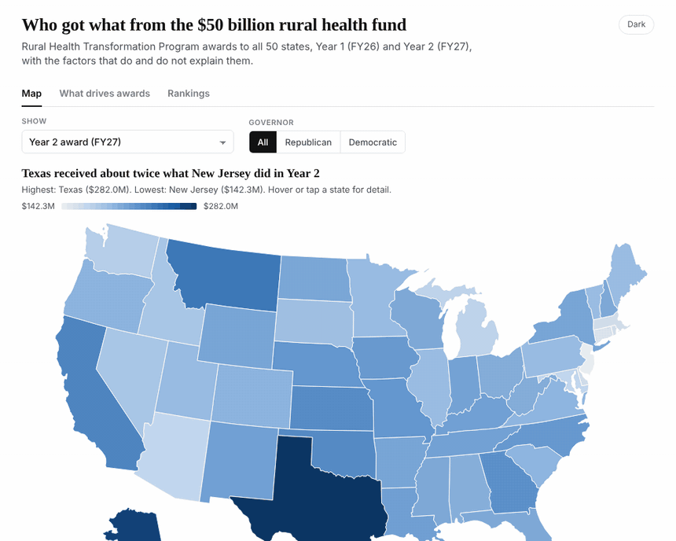
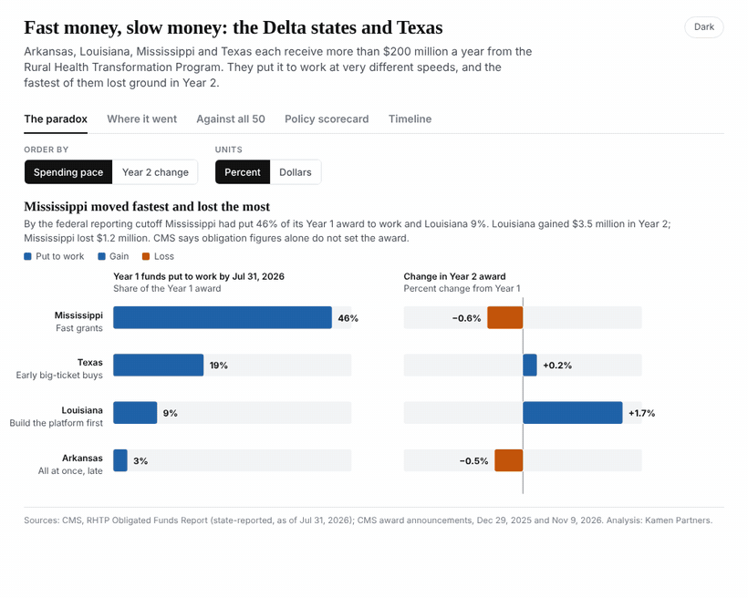

# portfolio

A place to share personal projects and coding examples on various topics, such as:
- finance
- operations
- forecasting
- statistics
- machine learning
- clinical / public health data
- x-omics (genomics, transcriptomics, metagenomics)

## Featured: Rural Health Transformation Program award analysis

Interactive, embeddable charts on how the $50 billion Rural Health Transformation Program (RHTP) was awarded to states in Year 1 (FY26) and Year 2 (FY27). Click a preview to open the live widget.

### Who got what from the $50 billion rural health fund

A 50-state explorer with a map, scatter plots of what does and does not drive awards, and rankings. Filter by measure and by governor's party; hover any state for detail.

**[Open the interactive explorer](https://eliabrodsky1.github.io/portfolio/rhtp-widgets/rhtp-award-explorer.html)** · [Source file](rhtp-widgets/rhtp-award-explorer.html)

### Fast money, slow money: the Delta states and Texas

Arkansas, Louisiana, Mississippi and Texas put their Year 1 money to work at very different speeds. The state that moved fastest lost ground in Year 2. Five views: the paradox, where the money went, the national comparison, a policy scorecard built from CMS records and a timeline.

**[Open the interactive regional widget](https://eliabrodsky1.github.io/portfolio/rhtp-widgets/rhtp-delta-states-explorer.html)** · [Source file](rhtp-widgets/rhtp-delta-states-explorer.html)

Both widgets are single self-contained HTML files with light and dark themes. Embedding instructions and data sources are in [rhtp-widgets](rhtp-widgets/).

## Other projects

| Project | Topic |
| --- | --- |
| [Portfolio diversification in Python](Python_portfolio_diversification.ipynb) | Finance |
| [Heart disease data analysis with Python and Plotly](Heart_Disease_Data_Analysis_Python_and_plotly_Tulane_MBA.ipynb) | Clinical / public health data |
| [Heart disease classification](Heart_Disease_Data_Analysis_Python_CASSIFICATION.ipynb) | Machine learning |

for more information: https://twitter.com/eliabrodsky
