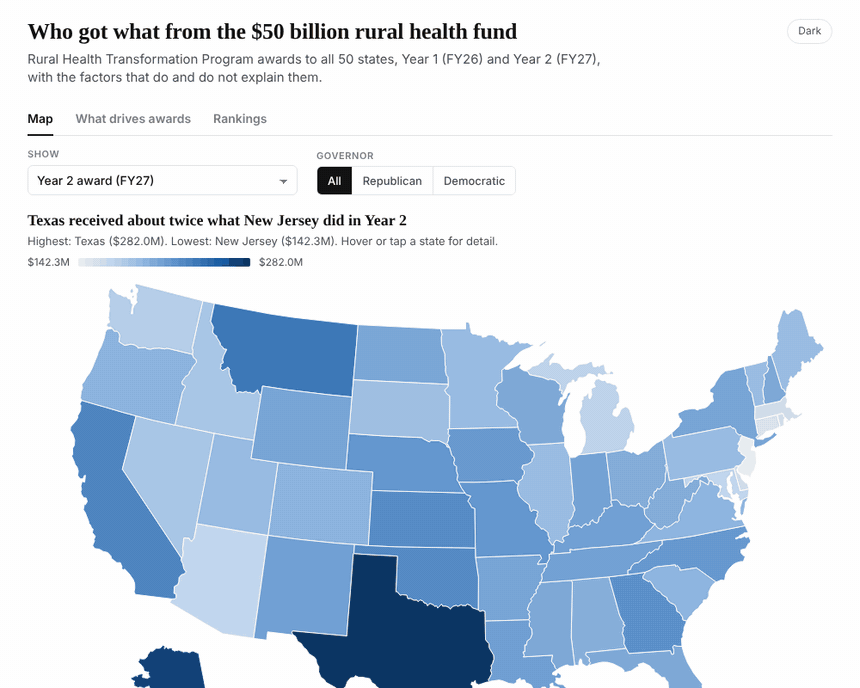
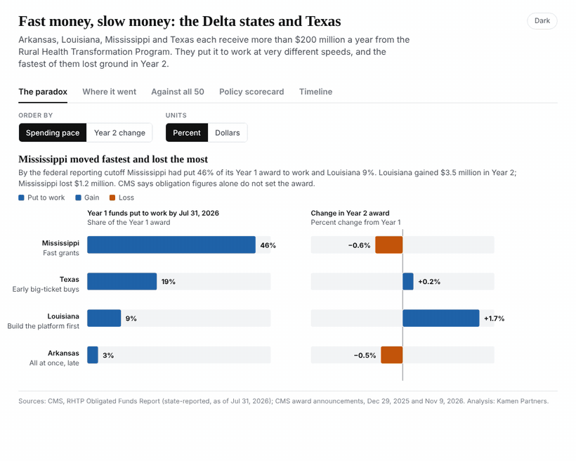

# RHTP award widgets

Two self-contained, embeddable HTML widgets on Rural Health Transformation Program (RHTP) awards. Each is a single file with its data inside; no build step.

## 1. 50-state award explorer

`rhtp-award-explorer.html`

Map, scatter plots and rankings for Year 1 (FY26) and Year 2 (FY27) awards, with filters and hover detail.



## 2. The Delta states and Texas

`rhtp-delta-states-explorer.html`

How Arkansas, Louisiana, Mississippi and Texas put Year 1 money to work, and how each fared in Year 2.



## Embedding

Host the HTML file, then:

```html
<iframe src="rhtp-award-explorer.html" title="RHTP award explorer"
  style="width:100%;max-width:980px;height:860px;border:0" loading="lazy"></iframe>
```

URL options: `?theme=light` or `?theme=dark` to lock the theme; `?tab=` to open on a tab
(`map`, `scatter`, `bars` for the explorer; `paradox`, `mix`, `scatter`, `policy`, `time` for the Delta widget).

## Sources

CMS award announcements (Dec 29, 2025 and Nov 9, 2026); CMS RHTP Obligated Funds Report (as of Jul 31, 2026);
CMS 50 State Spotlights; Census Bureau; KFF State Health Facts; state agency releases and news coverage.
Analysis: Kamen Partners.
